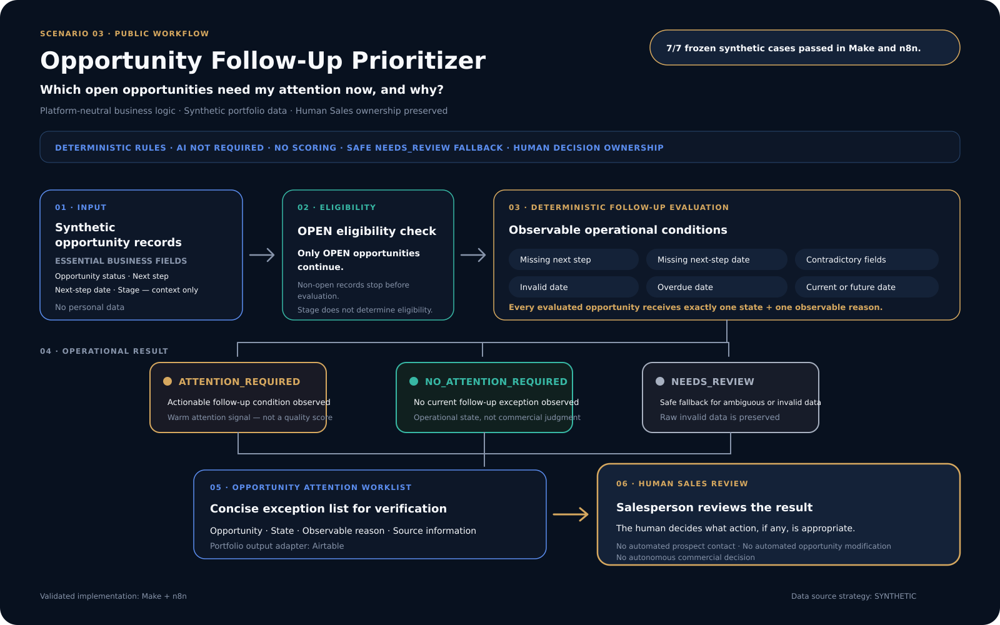

# Opportunity Follow-Up Prioritizer

**Sales Intelligence · Revenue Operations** · A specific opportunity-review application that identifies which open opportunities should be reviewed first and explains why using observable CRM follow-up signals.

## Business Application

In large portfolios, identifying which open opportunities require attention because of their follow-up, status, or available CRM data can become difficult and time-consuming. Incomplete next-step information, inconsistent follow-up, and unclear timing can make opportunity execution harder to manage.

This case study demonstrates one implementation pattern for that problem. It checks open opportunities against explicit, repeatable rules for next-step completeness and timing. It then assigns a clear review status, explains the observable reason, and prepares a queue for human Sales action. It does not predict whether an opportunity will close or score its quality.

This case study does not define the full Sales Intelligence domain. Broader Sales Intelligence solutions may address prospect, opportunity, account, expansion, pipeline, forecast, performance, productivity, and CRM-data questions using the decision logic appropriate to each business problem.

## Who It Helps

- Sales Teams
- Account Executives
- Sales Leadership
- Sales Ops
- RevOps

## What It Needs and What It Supports

The workflow needs the right opportunity information, not a specific CRM or storage product. It needs enough reliable, structured data to identify an open opportunity and evaluate whether its recorded next step is complete, valid, and current.

It supports a practical decision: which open opportunities should a Sales user review first, and why? The workflow prepares the review queue; a human Sales user decides and owns any follow-up action.

## Potential Operational Value

This implementation pattern may support:

- better prioritization of sales follow-up;
- lower risk of overlooking opportunities with observable follow-up issues;
- stronger follow-up discipline;
- better operational use of available CRM data; and
- less time spent manually reviewing opportunities for these conditions.

These are expected operational benefits, not measured outcomes. The portfolio validation does not establish time savings, pipeline impact, Sales effectiveness, ROI, or production performance.

| Status | Platforms | Validation data |
| --- | --- | --- |
| Implemented and validated | Make and n8n | Seven frozen synthetic opportunity cases |

> **Opportunity information → Explicit business rules → Human Sales action**

## At a Glance

| | |
| --- | --- |
| **Operational question** | Which open opportunities need attention now, and why? |
| **Evaluation scope** | Open opportunities |
| **Decision method** | Explicit, repeatable completeness and timing rules |
| **Operational states** | `Attention Required`, `No Attention Required`, `Needs Review` |
| **Operational output** | Airtable portfolio queue |
| **Decision owner** | Human Sales user |
| **AI** | Intentionally not required |
| **Deployment** | Portfolio implementation; not production deployed |

## Architecture

The diagram shows the shared business workflow validated in Make and n8n. Each platform implements that workflow in its own way while preserving the same business results and safeguards.

## Decision Contract

### Operational states

| State | Meaning |
| --- | --- |
| `Attention Required` | An observable follow-up issue requires attention |
| `No Attention Required` | The recorded next step is current |
| `Needs Review` | The source data is contradictory or invalid |

### Deterministic business logic

The workflow evaluates observable CRM-style fields rather than inferring intent, opportunity quality, probability, or value. At a high level, it checks whether:

- next-step information is missing;
- a next-step date is missing;
- next-step fields contradict each other;
- a supplied date is invalid;
- a valid next step is overdue; or
- a valid next step is current.

Problematic source values are preserved for review. The workflow does not autonomously contact prospects or make consequential Sales decisions.

### Why AI is intentionally not required

This scenario does not require language interpretation, generation, prediction, or probabilistic classification. Its signals are structured fields governed by explicit temporal and completeness rules.

Deterministic logic provides a transparent and testable implementation for this business question. AI is intentionally **not required**.

## Implementations

The same frozen business contract was implemented independently in:

| Component | Portfolio role |
| --- | --- |
| Make | Explicit routing with a separate output-adapter scenario |
| n8n | Deterministic evaluation using a platform-native workflow structure |
| Airtable | Operational portfolio output queue |

> **Business parity does not mean identical architecture.** The implementations preserve equivalent outcomes, rules, and safeguards without mechanically matching module or node structure.

## Validation Evidence

A frozen suite of **seven synthetic opportunity cases** was used on both platforms.

| Validation | Make | n8n |
| --- | --- | --- |
| Frozen synthetic cases | 7 | 7 |
| Passed | 7/7 | 7/7 |
| Business contract | Validated | Validated |

Make-to-n8n business parity was validated against the same frozen contract. The suite covered the documented rule boundaries:

- missing follow-up information;
- overdue and current next steps;
- contradictory fields;
- same-day handling; and
- invalid date handling.

> This evidence demonstrates functional behavior for the seven frozen synthetic cases. It is not evidence of production performance, predictive accuracy, customer outcomes, or universal Sales effectiveness.

## Safeguards and Responsible Automation

The validated portfolio implementation includes:

- evaluation restricted to open opportunities;
- mutually exclusive operational outcomes;
- explicit handling of invalid and contradictory data;
- preservation of problematic source values for review;
- stable opportunity identification for output updates; and
- human ownership of Sales action.

All validation uses synthetic portfolio data. No real customer or CRM data is required for this public case study.

The workflow intentionally avoids:

- lead or opportunity scoring;
- predictive forecasting;
- enrichment;
- autonomous outreach; and
- unsupported inference about buyer intent.

## Client Adaptation and Production Limitations

A client implementation needs the required opportunity information, not a particular software product. Depending on the client's authorized systems and operating context, that information could come from an appropriate CRM, Excel or another spreadsheet, Airtable, a data warehouse, a database, an API, or another structured source of truth.

Source flexibility does not mean every source is appropriate or interchangeable for every use case. The required fields, field meanings and mapping, data quality, business rules, review process, and access controls must be validated for each client. The destination for the review queue would also need to fit the client's authorized operating tools.

This portfolio version is not a production deployment. Depending on the target environment, production hardening could include monitoring, error handling, access controls, operational recovery, scale considerations, and platform-specific reliability measures.

These are adaptation considerations, **not implemented capabilities claimed for this portfolio scenario**.

## Scope

| Implemented and validated | Not claimed or implemented |
| --- | --- |
| Structured open-opportunity evaluation | Production deployment |
| Three mutually exclusive operational states | Predictive opportunity scoring or forecasting |
| Safe `Needs Review` handling | Enrichment or inferred buyer intent |
| Make and n8n business parity | Autonomous prospect outreach |
| Seven frozen synthetic test cases per platform | Customer ROI or customer outcomes |
| Human-owned Sales action | Regulatory compliance |

## Public / Private Boundary

This public case study presents the validated business workflow, deterministic rules, safeguards, and evidence. It intentionally does not publish raw workflow exports, exact mappings or expressions, resource IDs, credentials, private technical evidence, or other reconstruction-level implementation details.
